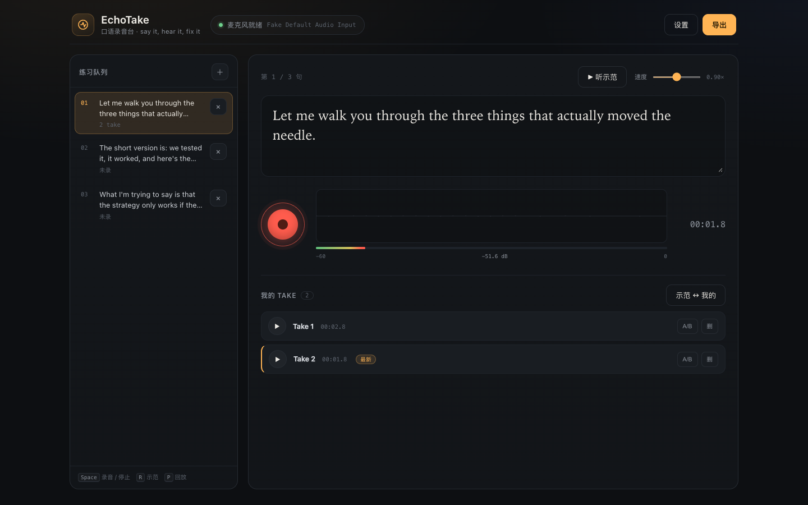

# EchoTake · 口语录音台

一个**本地优先**的英语口语练习录音器：把「听示范 → 录一遍 → 回放 → A/B 对比 → 重录」压缩成一句话内的循环，练完直接导出成 Obsidian 卡片。

为 `english-speaking-loop`（首说 → 3 个 chunk 微循环 → 完整重说 → 归档）设计，也适合任何需要反复重录、对比原声的跟读/演讲/面试练习。



## 为什么做它

现成的开源方案里：

- [Echoic](https://github.com/xialeistudio/echoic)（MIT，71★）功能最完整：音素评分、A/B 对比、导入音频。但需要 Docker + PostgreSQL，首次拉取约 1 GB 模型；而且录音留在它自己的库里，不接 Obsidian。
- [EchoTalk](https://github.com/alisolphp/EchoTalk)（MIT，30★）零安装 PWA，体验很好。但没有导出、不能导入自己的语料（Roadmap 尚未实现）。
- [youtube-shadowing](https://github.com/blacksnail789521/youtube-shadowing)（MIT，17★）绑定 YouTube + VLC，不适合「教练给一句、我马上重录」的流程。

EchoTake 不复刻它们的句库与评分，只做一件事：**让回听自己的原声这件事，低摩擦地发生**，并把证据留在你的笔记里。

## 快速开始

要求：macOS + Chrome（Safari 的录音与目录写入兼容性较差）。

```bash
# 方式一：双击
start.command

# 方式二：手动
cd speaking-take-recorder
python3 -m http.server 8765 --bind 127.0.0.1
# 打开 http://127.0.0.1:8765
```

首次按「录音」时允许麦克风权限。页面只在本机运行，不上传任何音频。

## 麦克风：闪克（Maono）PD200X

1. 用 USB-C 线直连 Mac（不要经过无供电 Hub；动圈麦不需要 48V 幻象电源）。
2. 系统设置 → 声音 → 输入 → 选 `PD200X`；输入音量保持 100%，用麦身上的增益旋钮控制。
3. 增益从 50%（12 点方向）开始，正常说话时页面电平表的峰值落在 **-12 ~ -6 dBFS**，不出现 `PEAK`。
4. 嘴离麦头 **5–10 cm**，正对网罩（心形指向，背面拾音少）；不要对着顶部吹气。
5. 录的时候戴耳机，用麦上的 3.5 mm 监听口直接监听，避免外放串音。
6. 页面录音固定 **48 kHz / 单声道**，并自动关闭系统的回声消除、降噪、自动增益——保留真实声音，方便听清齿音、尾音和连读。

更细的排障见仓库外层的 `麦克风设置_闪克PD200X.md`，一键检查用 `check_mic.command`。

## 练习方法（15 秒循环）

1. 把教练给的**一句**示范粘进中间的大字区（按 chunk 拆，不要整段）。
2. 点「听示范」或按 `R`，先听一遍标准节奏。
3. 按 `Space` 开始录，说完再按 `Space` 停；默认自动回放。
4. 点这条 take 的 `A/B`：先放示范，再放你的——只听一个差异点。
5. 按 `Space` 重录第二遍、第三遍；满意后 `→` 下一句。
6. 练完点「导出」，选一个文件夹；得到 `口语练习-日期-时间/练习记录.md` + `audio/*.webm`，拖进 Obsidian 即可。

一条 take 只改一个点。不要在第 1 遍就追求完美，第 3 遍才是今天的声音。

## 功能

- 按句队列：每句独立 take，进度可见
- 输入设备选择与自动匹配 PD200X
- 实时波形 + dBFS 电平表 + 削波提示
- 示范朗读（系统 TTS，0.6–1.2× 变速）
- 一键 A/B：示范 → 我的
- 录完自动回放
- IndexedDB 本地保存，刷新/重启不丢
- 导出 Markdown + 音频到任意文件夹（File System Access API）
- 键盘流：`Space` 录/停、`R` 示范、`P` 回放、`←/→` 换句
- 零依赖、零构建、零后端

## 数据与隐私

- 录音、句子、设置全部存在浏览器 IndexedDB（`echotake` 库）。
- 不做任何上传、埋点、账号。
- 「设置 → 清空全部练习」会删除所有 take；句子保留。
- 导出的文件由你选择落盘位置。

## 键盘

| 键 | 动作 |
|---|---|
| `Space` | 开始 / 停止录音 |
| `R` | 朗读当前示范 |
| `P` | 回放最近一条 take |
| `←` `→` | 上一句 / 下一句 |
| `⌘/Ctrl + Enter` | 在句子里直接开录 |

## 技术

纯静态：`index.html` + `styles.css` + `app.js`，无框架、无构建。

- MediaRecorder（Opus/WebM）
- Web Audio API（AnalyserNode 波形与电平）
- Web Speech API（TTS 示范）
- IndexedDB（takes / blobs / meta）
- File System Access API（导出；不支持时回退为下载）

## 开发

```bash
python3 -m http.server 8765 --bind 127.0.0.1
```

无 npm 依赖。改完刷新即可。

## License

MIT © 2026 huiyunxie

界面与句库为本项目原创；设计时参考了上述 MIT 项目的交互思路，未复制其代码。
